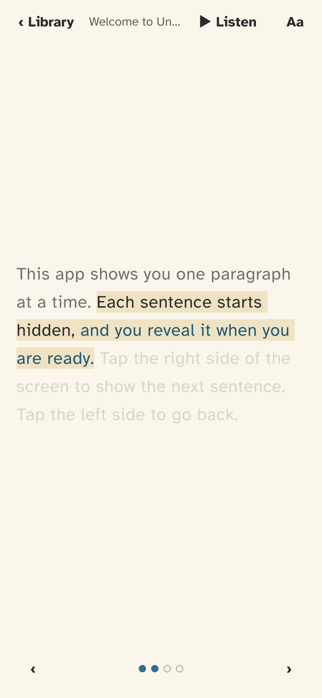
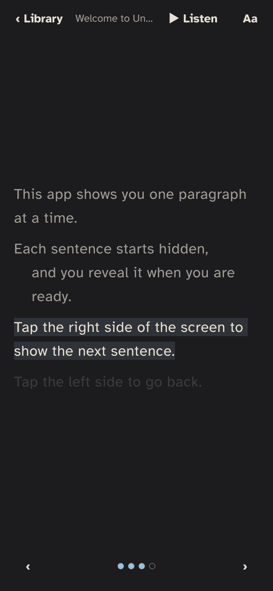
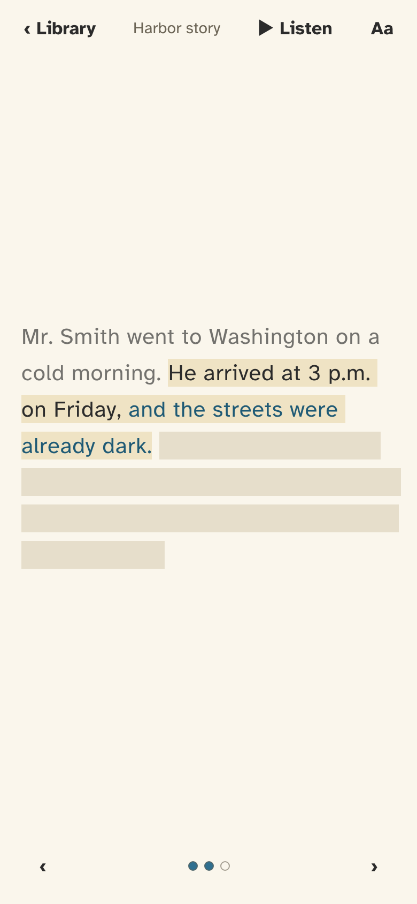
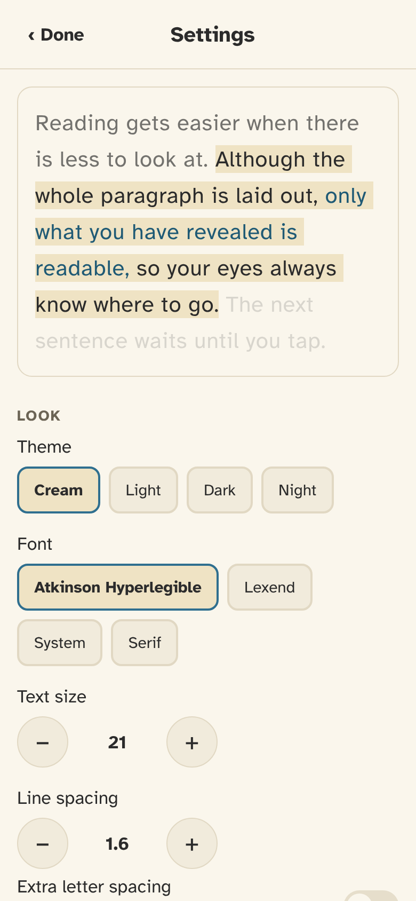
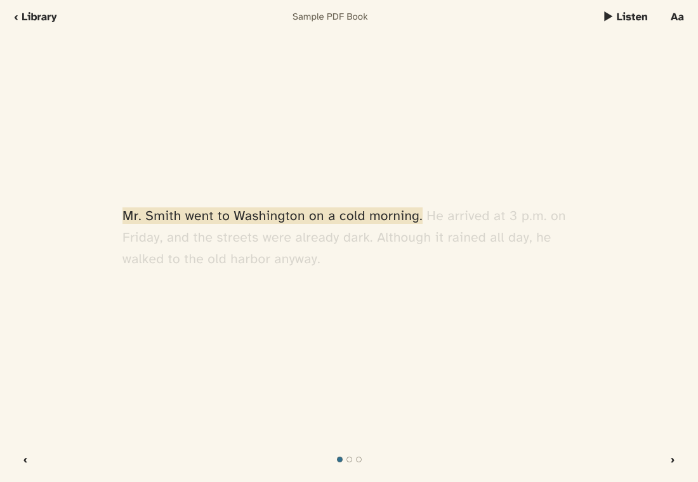
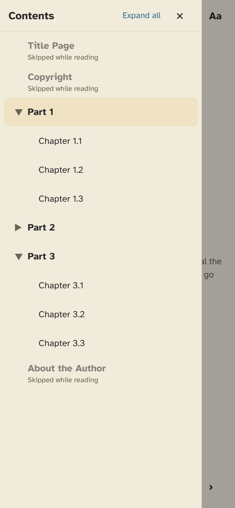
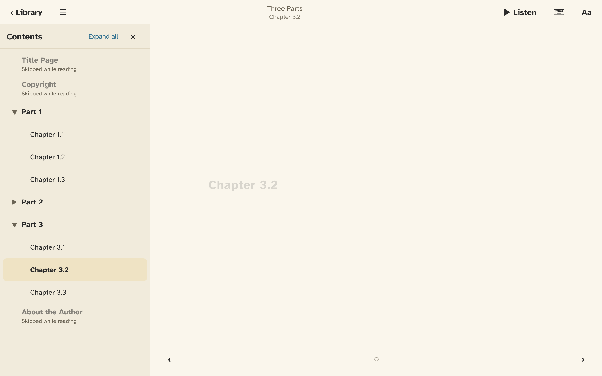
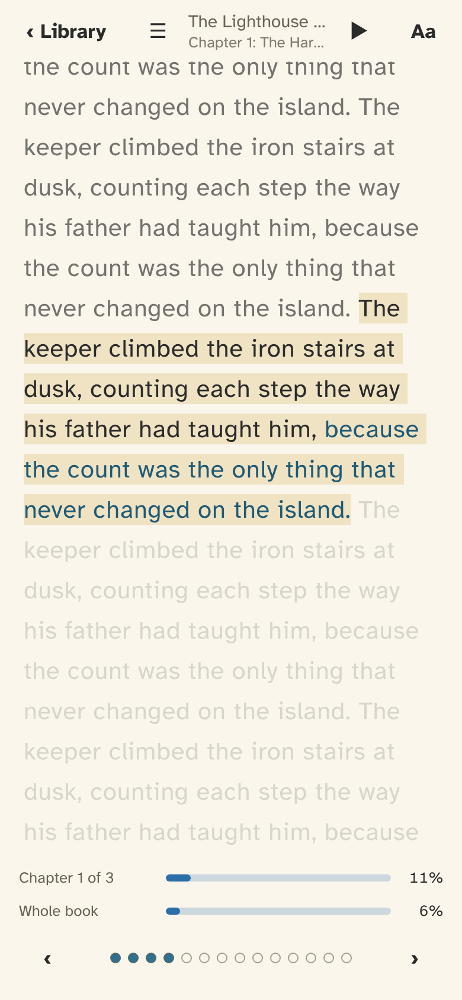

# Unfold — a sentence-by-sentence reader

Unfold is a reading app for **iPhone, Android and Windows** for people with ADHD, or anyone who finds dense pages hard to organise visually. It shows **one paragraph at a time**. Every sentence starts hidden, and you **tap right to reveal the next sentence** or **tap left to go back**. When a paragraph is finished, the next tap brings in a new paragraph with its text hidden again.

Inside the sentence you're reading, the clauses are made visible: either alternating tints, or a "cascade" layout with one clause per line.

| Reveal + clause tint | Cascade (dark) | "Bars" for unrevealed text | Settings |
|---|---|---|---|
|  |  |  |  |

On Windows, the desktop app looks like this:



## Supported documents
PDF (text-based), EPUB, Word `.docx`, OpenDocument `.odt`, RTF, HTML/XHTML, Markdown, FB2 and plain text. You can also paste text. Everything is parsed **on the device**, and nothing is uploaded.

## Finding the real text, and a table of contents
When a document is imported, `src/text/structure.ts` works out where the actual content begins and ends. It also rebuilds paragraphs that page breaks cut apart.

**Where reading starts and stops.** Unfold uses the first source that's available:
1. **Built-in table of contents:**
   - PDF bookmarks, read with pdf.js `getOutline()`
   - EPUB 3 `nav` or the EPUB 2 NCX
   - Word TOC fields, including their `_Toc` bookmarks
2. **Explicit markers:**
   - EPUB `landmarks` (bodymatter) and `<guide>`
   - EPUB `epub:type` section types (titlepage, copyright-page, backmatter…)
   - Project Gutenberg START/END lines
3. **A printed "Contents" page.** It's recognised by lines ending in page numbers or dot leaders, then matched to the headings that follow.
4. **Heuristics** for documents with none of the above:
   - copyright and legal wording (©, "all rights reserved", ISBN, "published by"…)
   - front-matter titles (dedication, contents…)
   - title-page fragments before the first chapter
   - back-matter titles (acknowledgments, about the author, notes, index…)

The result is a content range and a TOC. Front and back matter appear in the TOC as "skipped". Reading starts at the first chapter and stops before the back matter. You can turn this off with Settings → *Skip copyright, contents and back matter*.

**Page breaks.** For PDFs:
- A paragraph whose last line reaches the margin without finishing its sentence continues onto the next page.
- A paragraph continues at a sentence end too, unless its last line was short or the new page starts with an indent.
- Footnotes are dropped, along with their reference markers, so they can't split a paragraph.

Every format then gets a merge pass. It joins a paragraph that doesn't end a sentence to the next one when that one continues it: it starts lower-case, the cut fell after a word like "the" or "and", or a hyphenated word was split.

**Table of contents panel.** The ☰ button, or `C` on desktop, opens the contents:
- On phones it's a slide-over drawer. On windows 900px or wider it's a sidebar.
- Sections with sub-entries expand and collapse.
- The current chapter is highlighted and also shown under the book title.

| Contents drawer (phone) | Contents sidebar (desktop) |
|---|---|
|  |  |

## Progress bars
The bottom of the reader shows two progress bars:
1. **Chapter progress**, labelled "Chapter 2 of 3".
2. **Whole book or document.**

The sentence dots below them show progress through the current paragraph.

**Progress is measured by amount of text, not paragraph count**, and includes the sentences you've revealed in the current paragraph. The whole-book bar covers only the text you actually read, so skipped front and back matter doesn't count.

**Chapters are verified before the chapter bar is shown** (`src/text/chapters.ts`):
- There must be at least two divisions inside the reading range.
- They must split the text from near its start. If most of the text comes before the first heading, those headings don't count.
- When the top level is "Part One / Part Two" containers, the chapters inside them are used instead.
- Contents taken from the file itself or from a printed contents page are trusted.
- Contents guessed from headings must also pass size checks. Headings on nearly every paragraph are labels, not chapters.
- Headed divisions that don't read like chapters are labelled **"Section"**.
- With no verified chapters, only the whole-document bar is shown.

**Colours:** the bars follow the dataviz skill's meter-list pattern. Each theme's bar colour (`theme.meter`) passed its palette validator for lightness, colour strength and ≥3:1 contrast. The track is a lighter step of the same hue, and text uses normal text colours. You can switch the bars between *chapter + book*, *book only* or *off* in Settings.



## Design decisions (from the "council")
Three research passes shaped the app: reading UX for ADHD and low executive function, mobile architecture, and sentence/clause segmentation.

**Reading UX**
- **Typography defaults** come from the best-supported evidence (spacing, size, chunking):
  - Atkinson Hyperlegible font, 21pt, 1.6 line height, slight letter spacing.
  - A ~65-character column, left-aligned.
  - An optional *extra letter spacing* setting.
  - Lexend, system and serif fonts are also available.
- **Themes**: cream (the default, `#FAF6EC` / `#2B2B2B`), light, dark and a low-blue "night" theme. None uses pure black on pure white, and all meet WCAG AA.
- **The reveal mechanic**:
  - Unrevealed text is *faint* by default, so the paragraph shape is visible and nothing reflows. It can also be shown as *bars* or left *blank*.
  - The current sentence gets a soft highlight band.
  - Sentences you've already read soften (adjustable) but never disappear, so rereading is always possible.
  - Going back from the start of a paragraph returns you to the previous paragraph, fully revealed.
- **Clause structure**: *tint* alternates colour between clauses of the current sentence. *Cascade* puts each clause on its own indented line (visual-syntactic text formatting).
- **Low-overwhelm progress**: sentence dots for the current paragraph only. Whole-book progress is opt-in.
- **Position memory**: your exact sentence is saved on every tap. After 12+ hours away, a "Where you left off" recap shows the last sentences you read.
- **Listening**: an optional *read each sentence aloud* setting, plus a **Listen** mode that reveals and speaks sentence by sentence.
- **Gentle break reminder**: 25 minutes by default, adjustable, and can be turned off.
- **Bold word beginnings** ("bionic"-style) is **opt-in only**. Peer-reviewed tests show no speed benefit, but some people like it.
- **Accessibility**:
  - Tap targets of at least 48dp, plus large ‹ › buttons.
  - Haptic ticks.
  - VoiceOver/TalkBack treat the paragraph as an *adjustable* element: swipe up or down to step through sentences, and only revealed text is announced.
  - Reduce Motion is respected.
- **Long-press** reveals the whole paragraph. A *tap anywhere = next* mode is available for one-handed use.

**Segmentation** (`src/text/segment.ts`, no dependencies, Hermes-safe)
- Hermes has no `Intl.Segmenter`, and NLP libraries are heavy (compromise's clause support alone is about 340 KB), so Unfold uses a small rule-based splitter. It handles:
  - abbreviations (Mr., Dr., e.g., Fig. 3, Jan. 5) and initials (J. R. R.)
  - decimals, ellipses, URLs and emails, and quoted endings
  - numbered list items
  - "U.S. The…" vs "U.S. Army" disambiguation
- Clauses are split on `; : —` and on commas before conjunctions or subordinators (and after a leading "Although…, " clause). Guards prevent splits inside lists ("apples, pears, and plums"), inside quotes and parentheses, and in numbers like 1,000, and prevent fragments shorter than 3 words.

**Architecture**: Expo SDK 58 (React Native 0.88, TypeScript, Expo Router). One codebase builds both apps.
- **PDF**: `pdfjs-dist` runs inside a hidden `react-native-webview`, bundled offline and generated by `scripts/build-pdf-extractor.js` on `npm install`.
  - `src/parsers/pdf/layout.ts` rebuilds paragraphs from positioned text. It uses line gaps, indentation, short last lines and font-size jumps to find paragraphs and headings.
  - It also removes running headers/footers and page numbers, and repairs hyphenated line breaks.
- **EPUB / DOCX / ODT**: `fflate` for unzipping, `fast-xml-parser` and `htmlparser2`.
- **Storage**: books are stored as JSON in the app's documents folder. Settings and positions use the SQLite-backed `expo-sqlite/kv-store`.

## Project layout
```
src/app/            screens: library (index), reader/[id], settings, paste
src/components/     ParagraphView (reveal rendering), PdfExtractor (hidden WebView), ui
src/parsers/        txt, markdown, html, epub, docx/odt, rtf, fb2, pdf/{layout,types}
src/text/           segment (sentences/clauses), paragraph, navigation (tap logic), welcome guide
src/store/          settings, library + reading positions (*.web.ts = desktop/web storage)
src/hooks/          importer, file drop + keyboard shortcuts (desktop), asset readers
desktop/            Electron shell for Windows/macOS/Linux (main.js, build config, icons)
__tests__/          Jest tests for segmentation, every parser, PDF layout and tap navigation
```

## Run it
```bash
npm install          # also generates the offline PDF engine
npm test             # unit and parser tests
npx expo lint        # ESLint (eslint-config-expo)
npm run typecheck
npx expo start       # scan the QR code with Expo Go on iPhone or Android
```
Everything used is available in **Expo Go**, so no custom native build is needed to try it.

## Build installable apps
Builds run in the cloud with [EAS](https://docs.expo.dev/build/introduction/), so you don't need a Mac:
```bash
npx eas-cli@latest login
npx eas-cli@latest build -p android --profile preview   # an .apk you can sideload
npx eas-cli@latest build -p ios --profile production    # needs an Apple Developer account
npx eas-cli@latest submit -p ios                        # upload to TestFlight / App Store
```
The bundle ID and package name are `com.amyscorner.unfold` (set in `app.json`).

### Android APK without an Expo account
The **"Android build" GitHub Action** (`.github/workflows/android.yml`) builds `Unfold.apk` on a Linux runner. Run it from the Actions tab, or push a `v*` tag, and download the APK from the run's artifacts. To install it, copy it to your phone, open it, and allow "Install unknown apps" for your file manager or browser when Android asks.

To build the same APK locally, you need the Android SDK (Android Studio) and JDK 17+:
```bash
npx expo prebuild --platform android   # generates android/ from app.json (not committed)
cd android && ./gradlew assembleRelease # → android/app/build/outputs/apk/release/app-release.apk
```
This APK is signed with the debug key, which is fine for sideloading. Play Store uploads need EAS or your own keystore.

## Windows app
The Windows version is the same app wrapped in [Electron](https://www.electronjs.org/) (`desktop/`). It shares every parser, the segmenter and the reader with the phone apps.

Desktop additions:
- **Keyboard:** `→` / `Space` / `Enter` for the next sentence, `←` / `Backspace` to go back, `A` to reveal the whole paragraph, `L` to listen, `C` for the table of contents, `?` or `F1` for a shortcuts panel (also the ⌨ button), `Esc` to return to the library. `Ctrl +` / `Ctrl −` zooms and `F11` is full screen.
- **Drag and drop** a document onto the window to import it.
- **Mouse:** click the right or left side of the page, the same as tapping on a phone.
- **Storage:** books are kept in IndexedDB, and settings and positions in local storage, under the app's own `app://` origin. Everything persists between launches.
- **PDFs:** pdf.js runs in a hidden same-origin iframe, the same offline engine the phones use.

There are two Windows builds:

| Build | Size | Engine | Notes |
|---|---|---|---|
| **Lite** (`desktop-lite/`, Neutralinojs) | **~2 MB zip, single `Unfold.exe`** | The Microsoft Edge WebView2 built into Windows 10/11 | Recommended download. Your library is stored in your Windows profile (AppData), so you can move the exe freely. It uses local port 47781, so close any other app using that port. F11 fills the window with the page (maximise the window for full screen) and `?` shows the shortcuts. The Neutralino native API is disabled because its token handshake failed on Windows. Reloading and the browser right-click menu are disabled. |
| Full (`desktop/`, Electron) | ~150 MB | Bundled Chromium | Includes an installer and a menu bar. It doesn't depend on WebView2 being present. |

Build the lite version (this works from Linux, macOS or Windows, and needs no Wine):
```bash
npm run desktop:build:win:lite   # → desktop-lite/dist/Unfold/Unfold.exe
```

Build the full Electron version:
```bash
npm run desktop:start          # run the desktop app locally
npm run desktop:build:win      # Windows installer (.exe), portable .exe and .zip in desktop/release/
```
The NSIS installer step needs Windows, or Wine on Linux and macOS. The **"Windows build" GitHub Action** (`.github/workflows/windows.yml`) builds all three Windows packages on a Windows runner. Run it from the Actions tab, or push a `v*` tag, and download the files from the run's artifacts.

The same shell also builds for macOS (`dmg`) and Linux (`AppImage`) with `npx electron-builder --mac` or `--linux`.

The builds are **unsigned**, so Windows SmartScreen will show "Windows protected your PC". Click *More info → Run anyway*. Add a code-signing certificate to `desktop/package.json` to remove that warning.

## Known limits
- Scanned (image-only) PDFs have no text layer; OCR isn't included.
- Multi-column PDFs are read top-to-bottom per page, so columns may interleave.
- Clause splitting is heuristic. It doesn't split at "that"-clauses without commas, or inside lists of verb phrases.
